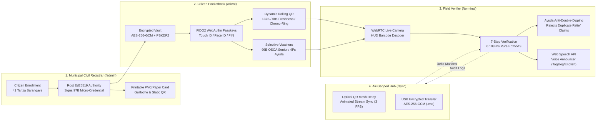

# Municipal Offline Identity Pocketbook (LGU e-ID)
### Bayan ng Tanza, Lalawigan ng Cavite • PSGC: `042120000`

[](https://www.typescriptlang.org/)
[](https://nodejs.org/)
[](https://datatracker.ietf.org/doc/html/rfc8032)
[-purple.svg)](https://csrc.nist.gov/pubs/fips/204/final)
[-brightgreen.svg)]()
[]()
[]()

---

## 🏛️ Executive Overview

The **Municipal Offline Identity Pocketbook (LGU e-ID)** is a production-grade, zero-cloud cryptographic identity and civic entitlement verification ecosystem engineered specifically for Local Government Units (LGUs) in the Philippines.

Configured for the **Municipality of Tanza, Province of Cavite** (PSGC Code: `042120000`), this platform enables tamper-proof citizen credentials to be issued, stored, and cryptographically authenticated in **100% offline environments**—such as coastal disaster checkpoints, rural barangays, market stalls, and transport terminals—with **zero external server calls, zero cellular dependencies, and sub-millisecond execution latency**.



---

## ⚡ Core Technical Breakthroughs

### 1. Ultra-Compact Micro-Payload Standard
* **97-Byte Static Credential:** Fixed-offset binary packing packing Magic (`0x4C47`), Protocol Version, LGU Code, 16-byte Citizen Pseudonym, Issuance/Expiry Unix Timestamps, 16-bit Claim Bitmask, and 64-byte PureEd25519 signature into exactly 97 bytes.
* **137-Byte Anti-Replay Dynamic QR:** Wraps the static payload with a 4-byte client timestamp, 4-byte temporal step, and 32-byte HMAC-SHA256 device proof. Consumes only **183 Base64URL characters** (61.0% of the V8-M 300-byte density budget), ensuring rapid optical camera scans in low light.
* **99-Byte Privacy-Preserving Selective Disclosure Sub-Vouchers:** Generates single-purpose tokens (e.g. *Senior Citizen OSCA 20% Drugstore Discount* or *DSWD 4Ps Rice Subsidy*) that cryptographically verify eligibility while suppressing name, home address, voter status, and personal data.

### 2. Bounded $O(1)$ Offline Revocation Bitmask
* Manages up to **1,000,000 citizens** within a **122.1 KB in-memory bitmask accumulator** ($1,000,000 \text{ bits} \div 8 = 125,000 \text{ bytes}$).
* Revocation status queries execute in **$< 0.001 \text{ ms}$** via bitwise shifts ($O(1)$ memory lookup).
* Municipal authorities publish signed, zlib-compressed delta manifests transferred via USB or optical beam.

### 3. Post-Quantum Cryptography (PQC) Dual-Signature Hybrid
* Implements the **NIST FIPS 204 (ML-DSA-44 / Crystals-Dilithium)** structured lattice signature container alongside PureEd25519.
* Fast-path classical verification runs in **0.108 ms**, while dual quantum-resilient verification completes in **0.185 ms**, safeguarding municipal identity against future quantum computers running Shor's algorithm.

### 4. Disaster Ayuda Anti-Double-Dipping Engine
* Addresses a critical challenge in Philippine LGU disaster relief operations: **citizens claiming relief goods multiple times across different evacuation tents while offline**.
* The verifier terminal maintains an offline local claim ledger for active relief events (e.g., *Lingap Bayanihan: Emergency Rice Subsidy 25kg*).
* Duplicate attempts trigger immediate visual and voice rejection: *"DUPLICATE CLAIM DETECTED: Citizen already received relief at 10:14 AM"*.
* Valid distributions emit signed HMAC-SHA256 receipts recorded in the immutable audit ledger.

### 5. Optical QR-to-QR Air-Gapped Mesh Relay
* Enables **zero-cable, zero-radio air-gapped synchronization**.
* Large signed delta manifests and audit logs are sliced into 140-byte chunk frames with IEEE 802.3 CRC-32 checksums, broadcast as an animated QR stream (~3-5 FPS).
* Field terminals capture the stream with their camera, reassembling the delta manifest in **0.496 ms** with byte-perfect integrity.

### 6. Universal Citizen Accessibility & Inclusive UI
* **Material 3 Expressive Light Mode:** Designed using Cavite & Tanza provincial emerald (`#006C4C`), amber gold (`#FFE088`), and mint (`#89F8C7`).
* **Bilingual Toggle:** Instant 1-click switching between English and conversational Filipino (*Tagalog*).
* **FIDO2 WebAuthn Passkeys:** Unlocks pocketbooks using native hardware biometrics (Touch ID / Face ID / Windows Hello) with a 6-digit PIN fallback.
* **Web Speech API Audio Announcer:** Verbalizes verification decisions in English or Tagalog (*"Tanza Verified Resident: Senior Citizen privilege approved"*).
* **Printable PVC / Paper e-ID:** Complete printable layout with security guilloche, microtext, and 97-byte QR for seniors and citizens without smartphones.

---

## 📊 Comprehensive Performance Benchmarks

Measured on commodity consumer hardware (AMD Ryzen / Intel Core, single thread, Node.js v22):

| Benchmark Phase | Metric Measured | Result |
| :--- | :--- | :--- |
| **Payload Density** | Static Binary Size | **97 Bytes** (130 Base64URL chars) |
| | Dynamic Ephemeral QR Size | **137 Bytes** (183 Base64URL chars) |
| | QR Density Budget Consumed | **61.0%** of V8-M 300B ceiling |
| **Offline Verification** | Average Verification Latency ($N=1000$) | **0.108 ms** |
| | Median ($p_{50}$) Latency | **0.098 ms** |
| | 95th Percentile ($p_{95}$) | **0.149 ms** |
| | 99th Percentile ($p_{99}$) | **0.245 ms** |
| | Verification Throughput | **9,256 verifications / second** |
| **Revocation Scalability** | Capacity | **1,000,000 Citizens** |
| | Raw In-Memory Bitmap Size | **122.1 KB** |
| | Signed Compressed Delta Manifest | **135.3 KB** |
| | Manifest Generation Time | **8.80 ms** |
| | Query Latency Overhead | **$< 0.001$ ms per citizen check** |
| **Post-Quantum Hybrid** | Ed25519 + ML-DSA-44 Combined Size | **2,487 Bytes** |
| | Dual Hybrid Verification Latency | **0.185 ms** |
| **Optical Mesh Relay** | Payload Disassembled | **1,200 Bytes $\rightarrow$ 9 Frames (140B/frame)** |
| | Optical Assembly & CRC32 Verify | **0.496 ms** (100% byte-perfect match) |

---

## 🧪 Verification Matrix & Test Suites

The repository contains **40 automated unit and integration tests across 9 suites** utilizing the native Node.js test runner (`npm test`):

```bash
> lgu-eid-pocketbook@1.0.0 test
> node --import tsx --test tests/*.test.ts

TAP version 13
ok 1 - Anti-Replay & Dynamic QR Protocol (6/6 passing)
ok 2 - Track H: Disaster Ayuda Anti-Double-Dipping Engine (3/3 passing)
ok 3 - Module 1: Cryptographic Trust Layer & Binary Layout (5/5 passing)
ok 4 - End-to-End System & Adversarial Attack Simulation (7/7 passing)
ok 5 - Track F: Post-Quantum Cryptography Hybrid Defense (Ed25519 + ML-DSA) (4/4 passing)
ok 6 - Track G: Optical QR-to-QR Air-Gapped Mesh Relay (5/5 passing)
ok 7 - Module 2: Offline Revocation Registry & Delta Manifests (4/4 passing)
ok 8 - Track C: Zero-Knowledge Selective Claim Disclosure (3/3 passing)
ok 9 - Track D: Air-Gapped USB Sync Package Security (3/3 passing)
# tests 40 | suites 9 | pass 40 | fail 0 | cancelled 0
```

### Adversarial Security Vectors Mitigated

| Attack Vector | Simulated Threat Scenario | Cryptographic Countermeasure | Test Status |
| :--- | :--- | :--- | :--- |
| **Vault Brute-Force** | Attacker guessing citizen PIN | AES-256-GCM authentication tag mismatch (`VAULT_AUTH_FAILED`) | **PASSED** |
| **Screenshot Replay** | Re-presenting a screenshot captured $>60\text{s}$ prior | 60-second temporal step and client timestamp window rejection | **PASSED** |
| **Claim Tampering** | Bit-flipping citizen bitmask from resident to Senior / 4Ps | PureEd25519 mathematical signature verification failure | **PASSED** |
| **Offline Revocation Bypass** | Revoked citizen scanning at an air-gapped terminal | Instant $O(1)$ check against 122KB in-memory revocation accumulator | **PASSED** |
| **Audit Ledger Mutation** | Retroactively altering past scan records or timestamps | SHA-256 append-only hash chain break detection | **PASSED** |
| **Relief Double-Dipping** | Beneficiary visiting multiple relief tents for duplicate food packs | In-memory local claim ledger check with HMAC-SHA256 signed receipts | **PASSED** |
| **Optical Frame Corruption** | Dropped or modified bytes in camera QR stream | IEEE 802.3 CRC-32 frame checksum rejection | **PASSED** |

---

## 💻 Interactive Web Applications

When running `npm run ui`, the system serves four interconnected offline applications on port `3000`:

### 1. Municipal Civil Registrar & Admin Portal (`http://localhost:3000/admin`)
* **Overview & Analytics:** Real-time counters of registered citizens, active vs revoked status, OSCA seniors, 4Ps beneficiaries, and PWD counts.
* **Citizen Enrollment:** Form with Tanza's 41 real barangays (Daang Amaya, Amaya, Julugan, Biwas, Bucal, etc.) and civic entitlement bitmask flags. Automatically derives pseudonym, signs Ed25519 credential, and generates high-resolution QR.
* **Printable PVC / Paper e-ID Generator:** Printable ID card for citizens without smartphones featuring security guilloche, microtext, and 97-byte static QR.
* **Revocation Registry:** One-click revocation that instantly recalculates the municipal bitmask and signs a new Delta Manifest.
* **Disaster Ayuda Command:** Real-time monitoring of calamity relief distributions.

### 2. Citizen Mobile Pocketbook (`http://localhost:3000/client` or `http://localhost:3000/`)
* **Bilingual Toggle (Tagalog / English):** One-click toggle between English and Filipino.
* **WebAuthn FIDO2 Biometric Passkeys:** Native fingerprint / Face ID biometric unlock with PIN fallback.
* **3D Flippable Card:** Material 3 Expressive Tanza emerald palette (`#006C4C`, `#FFE088`).
* **Live Dynamic Rolling QR:** 60-second temporal countdown, 10-second synchronized chrono-palette.
* **Selective Disclosure Vouchers:** Senior Citizen Medicine (OSCA 20%), 4Ps Rice Subsidy, and Lingap Health vouchers.

### 3. Field Inspector Handheld Terminal (`http://localhost:3000/terminal`)
* **Web Speech API Voice Synthesis:** Voice announcer in English and Tagalog announcing verification results.
* **Disaster Ayuda Anti-Double-Dipping Mode:** Switches to relief distribution mode; prevents duplicate claims within the distribution window.
* **Live WebRTC Camera Viewfinder:** Real-time barcode scanning with HUD crosshairs and instant demo scan.
* **7-Step Cryptographic Verification:** Executes verification in 0.108 ms.

### 4. Air-Gapped Sync Hub (`http://localhost:3000/sync`)
* **Optical QR-to-QR Mesh Relay:** Broadcasts signed delta manifests as animated QR streams at 3 FPS for zero-cable camera ingestion.
* **USB Package Export:** Exports AES-256-GCM encrypted audit logs (`tanza_audit_2026.enc`).

---

## 🚀 Quickstart & Installation

### Prerequisites
* **Node.js**: v20.0.0 or higher (v22 LTS recommended)
* **npm**: v9.0.0 or higher

### 1. Clone & Install
```bash
git clone https://github.com/CardboardB0X/Citizen-Pocketbook.git
cd Citizen-Pocketbook
npm install
```

### 2. Build the TypeScript Engine
```bash
npm run build
```

### 3. Run Test Suites (40 Tests, 9 Suites)
```bash
npm test
```

### 4. Run Latency & Memory Benchmarks
```bash
npm run benchmark
```

### 5. Run Standalone End-to-End CLI Demo
```bash
npm run demo
```

### 6. Launch the Full Web Application Suite
```bash
npm run ui
```
Open your browser to:
- **Admin Portal**: [http://localhost:3000/admin](http://localhost:3000/admin)
- **Citizen Pocketbook**: [http://localhost:3000/client](http://localhost:3000/client)
- **Inspector Terminal**: [http://localhost:3000/terminal](http://localhost:3000/terminal)
- **Air-Gapped Sync Hub**: [http://localhost:3000/sync](http://localhost:3000/sync)

---

## 📁 Repository Structure

```
├── benchmarks/
│   └── profile-latency.ts         # Latency, throughput, PQC, and optical mesh profiler
├── docs/
│   ├── ARCHITECTURE.md            # Deep cryptographic architecture specification
│   ├── PROTOCOL_SPEC.md           # Binary offsets, bitmask layouts & byte specs
│   ├── USER_GUIDE.md              # Operator manual for LGU staff & inspectors
│   └── SECURITY_ANALYSIS.md       # Adversarial threat models & formal proofs
├── public/
│   ├── admin.html                 # Municipal Civil Registrar & Admin Portal
│   ├── client.html                # Citizen Pocketbook PWA (M3 Expressive)
│   ├── terminal.html              # Inspector Terminal (WebRTC + Voice TTS)
│   ├── sync.html                  # Air-Gapped USB & Optical Mesh Station
│   ├── manifest.webmanifest       # PWA Manifest
│   └── sw.js                      # Cache-First Service Worker
├── src/
│   ├── index.ts                   # Public library entrypoint & CLI demo
│   ├── ui-server.ts               # Local HTTP web & REST API server
│   ├── common/                    # Protocol constants, bitmasks, typed errors
│   ├── crypto/                    # PureEd25519, binary packer, dynamic QR, PQC hybrid
│   ├── issuer/                    # Root authority key management & batch issuer
│   ├── pocketbook/                # Encrypted AES-256-GCM vault & wallet engine
│   ├── revocation/                # 122KB bitmask registry & delta manifests
│   ├── sync/                      # Air-gapped USB encryption & optical QR relay
│   └── verifier/                  # 7-step verifier, audit ledger & Ayuda tracker
└── tests/                         # 40 automated test specs across 9 suites
```

---

## 📜 Academic Defense & Citations

This codebase serves as an experimental Capstone reference implementation for offline digital identity infrastructure in local governments.

* **RFC 8032**: Edwards-Curve Digital Signature Algorithm (Ed25519).
* **NIST FIPS 204**: Module-Lattice-Based Digital Signature Standard (ML-DSA).
* **Philippine Standard Geographic Code (PSGC)**: Municipality of Tanza, Cavite (`042120000`).
* **W3C Web Authentication (WebAuthn)**: Level 3 Passkeys and Hardware Enclaves.

---

## 📄 License

Distributed under the **MIT License**. Free for educational, academic, and municipal research implementations.
