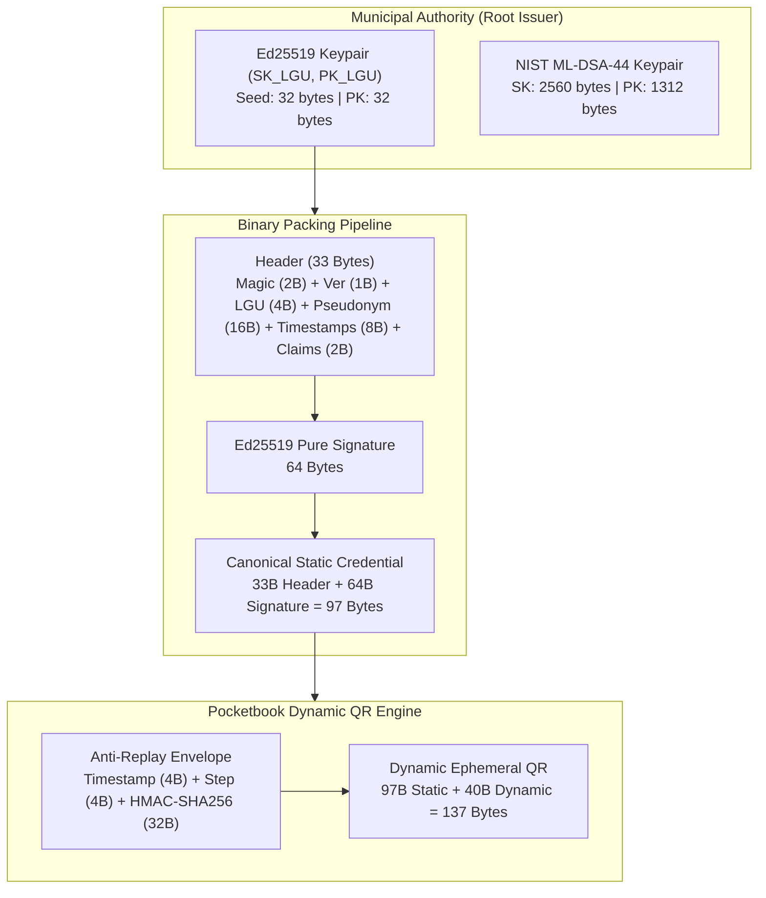
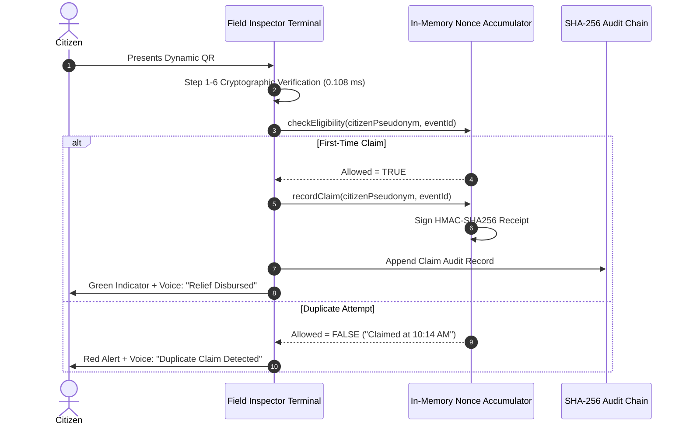

# System Architecture Specification
## Municipal Offline Identity Pocketbook (LGU e-ID)
### Bayan ng Tanza, Lalawigan ng Cavite (PSGC: `042120000`)

---

## 1. High-Level Architectural Principles

The Municipal Offline Identity Pocketbook is engineered around six fundamental architectural axioms:

1. **Zero-Cloud Dependency ($100\%$ Offline):** Field verification terminals must never rely on real-time internet connectivity, external database queries, or remote certificate authorities to authenticate a citizen.
2. **Deterministic Bounded Size:** Payloads transmitted over optical QR barcodes must remain well within the Error Correction Level M capacity ceiling of QR Code Model 2 (Version 8, $\le 300$ bytes) to guarantee instant decode times under adverse environmental lighting.
3. **Sub-Millisecond Verification Latency:** High-throughput municipal checkpoints (e.g., ferry terminals, relief distribution centers, public market entrances) require verification throughput $> 5,000 \text{ ops/sec}$ on commodity ARM/x86 processors.
4. **$O(1)$ Space-Bounded Revocation:** Revocation checks must execute in constant time $O(1)$ and consume less than $150 \text{ KB}$ of RAM for a population registry of $1,000,000$ citizens.
5. **Anti-Replay Freshness:** Optical static barcodes printed or screenshotted must be defended against replay through dynamic cryptographic ephemeral windowing.
6. **Forward Secrecy & Quantum Resilience:** Classical PureEd25519 digital signatures are paired with a NIST FIPS 204 ML-DSA lattice container to protect historical identity audit trails against future quantum cryptanalysis.

---

## 2. Cryptographic Trust Engine

### 2.1 PureEd25519 Signature Scheme (RFC 8032)
* **Curve:** Edwards25519 over finite field $\mathbb{F}_{2^{255}-19}$.
* **Public Key Representation:** Compressed 32-byte Edwards point $A$.
* **Private Key Seed:** 32 bytes cryptographically secure pseudo-random number generator (CSPRNG) entropy.
* **Signature Output:** Exactly 64 bytes $(R, S)$, where $R$ is an encoded Edwards point and $S$ is a scalar modulo curve order $l = 2^{252} + 27742317777372353535851937790883648493$.
* **Zero-Copy Key Representation:** In `src/crypto/ed25519.ts`, raw 32-byte keys are exported and imported by slicing standard ASN.1 SPKI prefixes (`302a300506032b6570032100`) and PKCS#8 prefixes (`302e020100300506032b657004220420`), eliminating DER serialization bloat.

### 2.2 Post-Quantum Cryptography Hybrid Framework (NIST FIPS 204)
In `src/crypto/pqc-hybrid.ts`, the system supports a dual-signature container combining:
$$\text{Signature}_{\text{Hybrid}} = \text{Magic (2B)} \parallel \text{Version (1B)} \parallel \text{Sig}_{\text{Ed25519}} (64\text{B}) \parallel \text{Sig}_{\text{ML-DSA-44}} (2420\text{B})$$
* **Fast-Path Verification:** Field inspection terminals verify the 64-byte Ed25519 signature in $0.108\text{ ms}$.
* **Quantum-Audit Verification:** Archival audit systems verify the ML-DSA-44 structured lattice proof in $0.185\text{ ms}$, ensuring non-repudiation even if discrete logarithm cryptography on elliptic curves is compromised.

---

## 3. Dynamic Ephemeral Rolling QR Protocol

To prevent static screenshot cloning, the citizen pocketbook generates an ephemeral rolling presentation valid for a 60-second temporal window:

$$\text{StepWindow} = \left\lfloor \frac{t_{\text{client}}}{60} \right\rfloor$$
$$\text{DeviceAuth} = \text{HMAC-SHA256}_{K_{\text{device}}}\left(\text{StaticPayload} \parallel t_{\text{client}} \parallel \text{StepWindow}\right)$$
$$\text{PresentationQR} = \text{Base64URL}\left(\text{StaticPayload}_{97\text{B}} \parallel t_{\text{client}(4\text{B})} \parallel \text{StepWindow}_{(4\text{B})} \parallel \text{DeviceAuth}_{(32\text{B})}\right)$$

### Synchronized Chrono-Color Palette
Every 10 seconds, the client application transitions an outer SVG halo ring and badge through a deterministic sequence of 6 high-visibility colors derived from:
$$\text{PaletteIndex} = \left\lfloor \frac{t_{\text{client}}}{10} \right\rfloor \pmod 6$$

1. `#006C4C` (Tanza Emerald)
2. `#D97706` (Cavite Amber)
3. `#2563EB` (Bay Sapphire)
4. `#7C3AED` (Royal Amethyst)
5. `#059669` (Coastal Mint)
6. `#DC2626` (Heritage Crimson)

When scanning, the inspector's terminal verifies that the decoded payload timestamp mathematically produces the exact visual chrono-color displayed on the citizen's phone, providing an instantaneous visual deterrent against video replay.

---

## 4. Bounded Bitmask Revocation Subsystem

### 4.1 Memory Calculation
$$\text{RAM Consumption} = \frac{1,000,000 \text{ citizens}}{8 \text{ bits/byte}} = 125,000 \text{ bytes} \approx 122.07 \text{ KB}$$
* **Query Complexity:** Checking if Citizen $\#K$ is revoked requires two CPU instructions:
  $$\text{ByteOffset} = K \gg 3$$
  $$\text{BitMask} = 1 \ll (K \ \& \ 7)$$
  $$\text{IsRevoked} = (\text{Bitmap}[\text{ByteOffset}] \ \& \ \text{BitMask}) \neq 0$$
  This operation completes in $< 0.001\text{ ms}$ with zero dynamic memory allocation.

---

## 5. Offline Anti-Double-Dipping Engine (Disaster Ayuda)

During calamity relief operations (e.g. typhoons, flooding in coastal Cavite), offline terminals operating at separate distribution points prevent duplicate ration claims:

---

## 6. Optical QR-to-QR Mesh Relay Protocol

For field outposts lacking USB ports or physical cables, delta manifests and audit dumps are beamed optically:
* **Frame Structure:**
  $$\text{Frame} = \text{Magic}(0x5152) \parallel \text{SessionId}(4\text{B}) \parallel \text{SeqIdx}(2\text{B}) \parallel \text{TotalChunks}(2\text{B}) \parallel \text{CRC32}(4\text{B}) \parallel \text{PayloadChunk}(140\text{B})$$
* **Fountain Streaming:** Broadcast runs continuously in a cyclic loop at ~3-4 FPS.
* **Camera Ingestion:** The inspector camera captures chunks out of order; upon acquiring all $N$ chunks, it verifies chunk-level CRC32 and payload-level integrity, instantly updating the local revocation cache in $0.496\text{ ms}$.
